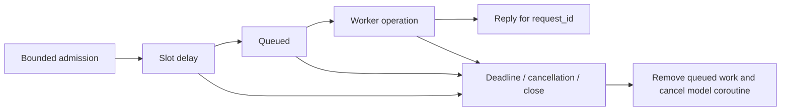

# Consultation lifetime and worker cancellation

The corpus callosum owns each consultation from admission through dispatch and
completion. This is the first execution-control layer beneath deliberation:
expired work is removed, replies identify an exact attempt, and caller abandonment
reaches the model coroutine without terminating the worker pump. It applies to
standard stdio EngineSession and interactive `run_server.py`, including detail,
critic and lead requests. It is an in-process asyncio protocol, not a separate
brainstem service or a simulation of biological autonomic physiology.

## Identity and deadlines

`qid` identifies a dialogue turn. Each `ask_detail` call generates a fresh
`request_id`, even for concurrent or repeated calls sharing a qid. User-supplied
request IDs are replaced. Input payloads are deep-copied so callers cannot mutate
an admitted packet. Returned replies carry the authoritative qid and request_id.

The timeout starts at call entry and covers slot delay, queue residence and model
execution together. Slotting now delays **dispatch**, rather than starting work
while artificially delaying receipt. The slot consumes the timeout budget. An
optional `deadline=` further shortens the budget; it is an absolute value from
the same loop's `loop.time()`, not a wall-clock timestamp or a deadline that can
be carried unchanged between processes. Workers receive `deadline_at` for
diagnostics; execution uses the bus's authoritative stored deadline.



Queued work is removed on abandonment, and `recv_request` rejects expired work
again before delivery. `run_request` checks the lifetime before invoking the
operation and after completion. Late, duplicate, qid-only and otherwise unmatched
replies are rejected; they cannot complete another attempt. An abandoned model
result is discarded even if a client catches cancellation and returns text.

## Capacity and shutdown

The default capacity is **64** per bus. It counts pending reservations (including
slot delay) and model operations still draining after their callers leave, without
double-counting an attached operation. A new call exceeding capacity raises
`CallosumOverloaded` immediately and admits no work. This bounds consultation
counts, not payload bytes, model tokens or the number of sessions.

Both standard entry points accept `DUALBRAIN_CALLOSUM_MAX_PENDING`, a positive
integer applied when creating a session/bus. Direct users can construct
`Callosum(max_pending=...)`. A slot is reusable after the associated operation has
actually stopped, rather than merely after its caller gives up.

Closing rejects new calls, clears queued work, wakes receivers and waiting
callers, cancels tracked operations and awaits their termination. EngineSession
and the interactive server close the channel during shutdown. Cancellation is
sent once while a model is already stopping, so simultaneous expiry/close does
not interrupt its asynchronous cleanup with another cancellation. Cancelling a
shutdown waiter leaves that cleanup owned and tracked. Cancellation is
cooperative: built-in asynchronous clients can release their request, but a
custom client that blocks the event loop or indefinitely ignores cancellation
cannot be forcibly stopped by this Python object. It can delay worker recovery
and shutdown. Its occupied capacity remains visible and cannot be bypassed by
submitting more consultations. Stopping local work also cannot revoke a request
already accepted or billed by an external provider.

## Worker migration

**Custom consumers must reply using request_id, not qid.** There is deliberately
no qid fallback, because an old response can arrive during a newer attempt.
Consumers should also use `run_request` to bind model work to caller cancellation:

```python
request = await bus.recv_request()
try:
    result = await bus.run_request(request, lambda: compute(request))
except RequestAbandoned:
    pass  # keep the pump alive for the next request
else:
    await bus.publish_response(request["request_id"], result)
```

The pump should exit on `CallosumClosed` and propagate actual cancellation of the
worker itself. `core/right_worker.py` provides this shared implementation for both
standard servers. Unsupported request types return an error immediately. Escaping
provider exceptions expose their type rather than private exception text.
`EnhancedCallosum` forwards lifetime methods and slot settings; closing and model
cancellation bypass its GABA data filter. The extension remains opt-in.

`snapshot()` replaces inspection of the old response map and queue. It returns
capacity, occupied/pending/queued/running counts, shutdown status and cumulative
overload, expiry, cancellation and discarded-response counters, without qids,
request IDs or payload text. Expiry/cancellation counters cover admitted calls;
already-expired calls rejected before admission are not included. The stdio health response adds aggregate
`consultations` counters. Health requests still use the existing RPC loop; this
is not an independent heartbeat or a background watchdog.

## Scope and verification

The guarantee covers **one consultation hop**. It does not yet impose a common
deadline on an entire user turn, nor forward a Gateway HTTP disconnection into
Python turn cancellation. The existing serial RPC reader, per-session state,
stream output and persistence need a separate design for that outer lifecycle.
Transport request IDs are ephemeral and do not replace durable
`memory_operation_id` receipts or undo already committed memory. The independent
MemoryBus/replay transport is unchanged.

Model-free regressions cover shared-qid concurrency, late replies, payload mutation,
slot/queue deadlines, cancellation in every request mode, bounded admission,
slow cancellation acknowledgement, shutdown, worker survival, error redaction,
wrapper behavior and actual EngineSession health/shutdown. The queued-timeout
case verifies that expired work behind a busy model never invokes the model.
No new paid quality measurement or token/latency improvement is claimed.
