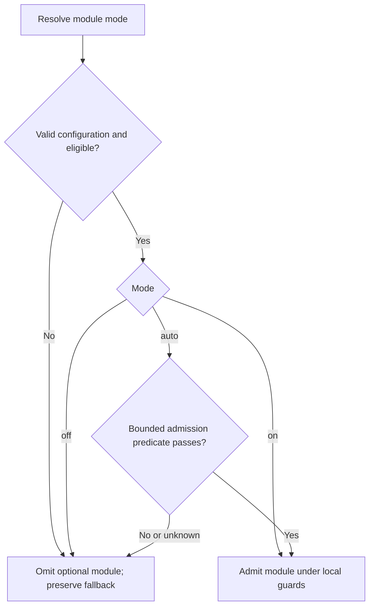

# Optional module admission (prototype)

`ThalamicReticularNucleus` admits or inhibits optional processing using cheap,
deterministic turn facts. The thalamic reticular nucleus (TRN) is a narrow analogy
for inhibitory relay control. This prototype does not model biological fidelity,
executive authority, or a global brain power switch. It introduces no learned
feedback policy, model classifier, or recursive meta-router.

| Component | Responsibility |
| --- | --- |
| `Thalamus` | Relay selected memory streams into context. |
| `SalienceNetwork` / `PredictiveCodingController` | Produce control signals and processing-demand estimates. |
| `BasalGanglia` | Select cooperative actions. |
| `Hypothalamus` | Bias processing from resource pressure and feedback. |
| `ThalamicReticularNucleus` | Decide whether a registered optional module may run. |
| Admitted module | Produce its own result under its existing local guards. |

## Inventory and controls

The registry is explicit and immutable. Defaults preserve the existing
switches; introducing the registry does not activate automatic policies.

| Functional module ID | Owning controller method | Default | Legacy switch |
| --- | --- | --- | --- |
| `conversation_selective_consultation` | `_run_routing_stage` (post-draft) | `off` | `DUALBRAIN_CONVERSATION_SELECTIVE_CONSULT` |
| `acc_monitor` | `_run_conflict_regulation_stage` (final answer) | `on` | `DUALBRAIN_ACC_MONITOR` |
| `cerebellar_correction` | `_run_conflict_regulation_stage` (final answer) | `on` | `DUALBRAIN_CEREBELLUM_MICRO_CORRECTION` |
| `default_mode_reflection_injection` | `_run_unconscious_resonance_stage` | `on` | None; existing suppression/cooldown remain |
| `system2_stalled_followup` | `_run_system2_refinement_stage` | `on` | `DUALBRAIN_SYSTEM2_STALLED_FOLLOWUP` |
| `executive_advice` | `_prepare_observer_stage` | `on` within requested caller mode | `executive_mode=observe/assist/polish` remains required |
| `director_advice` | `_prepare_observer_stage` | `on` within requested caller mode | `executive_observer_mode=director/both` remains required |
| `executive_metrics_observation` | `_run_post_turn_observer_stage` | `on` within requested caller mode | `executive_observer_mode=metrics/both` remains required |
| `acc_consult_promotion` | `_run_routing_stage` | `off` | `DUALBRAIN_ACC_OVERRIDE_CONSULT` |
| `acc_system2_promotion` | `_run_routing_stage` | `off` | `DUALBRAIN_ACC_SYSTEM2_BUMP` |
| `acc_temperature_adjustment` | `_run_routing_stage` | `on` when amount is positive | `DUALBRAIN_ACC_TEMPERATURE_DROP` remains the amount, default `0` |
| `basal_consult_promotion` | `_run_routing_stage` | `on` under the existing loop recommendation | None; ACC/salience-driven consultation override |

All twelve entries are connected to their production admission point. The nine
follow-on migration candidates are implemented; no candidate in this inventory
is a registration-only placeholder. This inventory covers optional work selected
by the controller's public modes/enable switches plus DMN prompt injection.

Canonical configuration is `DUALBRAIN_MODULE_<UPPER_ID>_MODE=on|off|auto`.
For example, configure automatic decisions for subsequent turns with:

```bash
export DUALBRAIN_MODULE_CONVERSATION_SELECTIVE_CONSULTATION_MODE=auto
export DUALBRAIN_MODULE_ACC_MONITOR_MODE=auto
export DUALBRAIN_MODULE_CEREBELLAR_CORRECTION_MODE=auto
```

The canonical variable wins when present, including when its value is invalid.
Existing Boolean `1`/`0` aliases remain supported. If neither canonical nor legacy
configuration is present, use the inventory default. An invalid explicit value
disables that optional module and produces a bounded configuration reason.

- `off`: omit this optional module at its registered phase.
- `on`: admit it when eligible; existing local guards still apply.
- `auto`: admit it only when eligible and its bounded automatic predicate passes.

Eligibility and protected controls veto even `on`. Automatic admission never
bypasses a module's checks. For the selective router, disabled means retain legacy
consultation routing; it does not mean consultation or System2 is forced off.
ACC monitoring and cerebellar correction keep their independent controls.
`acc_monitor` controls final-answer monitoring only. Pre-routing ACC interventions
have three independent registrations and keep their configured signal thresholds.
For temperature adjustment, `on` cannot invent a positive drop amount.

The remaining controls have an explicit disposition:

| Existing control | Current owner | Treatment |
| --- | --- | --- |
| `system2_mode` and `DUALBRAIN_SYSTEM2_PRIORITY*` | System2 activation/settings | Protected caller mode and priority; preserve authority. |
| `DUALBRAIN_SYSTEM2_LOW_SIGNAL_FILTER` | System2 refinement | Keep validation local. |
| `DUALBRAIN_CRITIC_MICRO_FALLBACK`, `DUALBRAIN_CRITIC_JSON_REPAIR_CALL`, `DUALBRAIN_CRITIC_MICRO_SANITY_OVERRIDE` | Right-model critic | Keep response-contract recovery and validation local; these are not optional cognitive admission. |
| `executive_mode`, `executive_observer_mode` | Caller | Retain named output/director semantics; TRN may omit a selected function but cannot select a mode that was not requested. |
| `REASONING_DIAL` | Engine reasoning settings | Selects a reasoning mode rather than optional execution. |
| Memory scope/support/currentness, commit/recovery and embedding availability | Memory pipeline | Mandatory evidence and lifecycle contracts; retain local ownership. |
| Deadlines, cancellation, request identity, capacity and stream/vision I/O | Engine / callosum / Gateway | Operational contracts; retain local ownership. |
| Audit/sanitization and critic filtering | Answer validation | Mandatory validation; retain local ownership. |

Salience, prediction, thalamic relay and hypothalamic resource signals stay fact
producers. Unconscious analysis and DMN history/cooldown updates also stay active
as fact/state producers. The excluded controls are intentionally retained, rather
than unfinished migration candidates. New optional execution sites must join the
registry under the rules below; a new inventory item needs an explicit disposition.



## Automatic predicates

Selective consultation requires guarded conversation memory, an answerability
gate, a left-led turn, capable System2 in `auto`, and non-precision priority
(`balanced` or `latency`). Source
writes, forced-right leads, director force/skip, precision preference, and existing
ACC/amygdala overrides retain authority. System2 `auto` defaults to **precision**;
selective routing still requires an explicit non-precision choice, such as
`DUALBRAIN_SYSTEM2_PRIORITY_AUTO=balanced`. The registry never changes that choice.

Its automatic predicate accepts only a positively recognized single literal
record-repeat request, a resolved reference, one currently approved record,
exact complete draft/source-answer equality (ignoring outer whitespace),
high finite confidence (`>= 0.85`), and zero
risk. These facts supplement the existing support and source-lifecycle checks.
Recognized requests include “Repeat the recorded answer for Project Amber verbatim”
and “Amberの記録をそのまま再掲して”; identity aliases are removed by the existing
scope resolver before whole-request matching. Other phrasing falls back normally.
Unknown coverage, reasoning, review, calculations, or multiple requested
conditions retain legacy routing. In `auto`, only a child router's `skip` proposal
may change routing; `consult` and `defer` preserve the legacy decision. Manual
`on` preserves the existing router's full skip/consult/defer behavior within scope.

ACC automatic admission requires a known cheap micro-critic result or a
risk/uncertainty signal (finite risk above zero or confidence below `0.85`).
A known micro result has a recognized domain, including a clean result;
an unknown domain alone does not trigger observation.
Cerebellar automatic admission requires known,
high-confidence issues (`>= 0.88`, one to four issues in v1). Its forward forecast,
external-model availability, correction thresholds, and subsequent checks still
decide whether correction runs. Admission is not an assertion of correctness or
a promise that a provider call will occur.

DMN automatic injection requires a generated reflection with finite confidence
`>= 0.6`, finite task-positive load below `0.62`, and finite zero risk. Existing
low-focus streak, thalamic and predictive suppression veto all modes, including
`on`. Reflection generation still advances history and cooldown even when prompt
injection is `off`. Private/debug reflection records remain separate from injection.

Executive advice, director advice and post-turn metrics use a non-empty,
nontrivial-input AUTO predicate. Caller modes and model availability are hard
eligibility requirements. Defaults preserve requested `observe`/`assist`/`polish`
behavior; AUTO may omit the selected function on trivial input and never converts
one named mode into another. Advice/director admission happens before task creation;
metrics admission happens after a final answer. Existing timeouts and cancellation
ownership continue to govern admitted work.
The Director's caller-selected deterministic trivial-chat steering is separate
from its provider task: it keeps consultation skipping, short output and long-term
memory suppression even when the optional task is off, inhibited or unavailable.
An observer mode that does not request Director applies no such control.
Director consultation skipping cannot suppress an explicitly active System2 `on`.

Pre-routing ACC AUTO requires known micro issues (one to six), finite micro
confidence `>= 0.86` and finite conflict `>= 0.75`, in addition to existing
configured thresholds. The three interventions are independent; System2 promotion
also requires inactive, capable System2 in caller `auto` mode. Lowering the local
threshold cannot lower these versioned AUTO floors. Disabling all interventions
avoids their shared micro/monitor preparation.

The basal loop's consultation promotion is a separate admission site: computing
ACC facts must not silently bypass a declined AUTO intervention through that loop.
Basal signal computation stays active under its existing conditions. Its AUTO
promotion requires the same strong micro/conflict facts or the existing salience
memory-recall/System2 pressure signal; trivial turns are omitted. Its default `on`
preserves the old loop recommendation path, independently of direct ACC promotion.

Stalled-follow-up admission controls only the extra stalled checklist path;
ordinary progress-based follow-ups keep their existing policy. Remaining issue
count, lack of progress, configured minimum issue count and a third-round budget
remain hard guards. AUTO additionally needs an unresolved structured external
`issues` verdict, critic detail, finite confidence `>= 0.85` and at most six
remaining calibrated issues. Unknown/unstructured critique cannot trigger it.

Literal completeness comes first because the selective pilot passed **6/7 jointly
graded trials versus legacy's 7/7**. The missing case involved requested capacity
labels despite a correct numeric result; selective and forced-on both missed it.
Aggregate selective 7/8 includes a passing case unavailable in legacy and does
not establish preserved quality. See the [measured result](benchmarks/selective-consultation-2026-11-01.md).
This prototype makes no broad automatic-activation, quality, or paid cost claim.
The [first twelve-gate pilot](benchmarks/module-gating-2026-11-01.md) retained
8/8 graded answers in both profiles with 22 versus 19 processing attempts. It
also exposed replacement work on trivial turns, deadline cancellations and seven
gates without positive AUTO exposure; those limits govern the next work.

## Facts and observability

Policies consume typed, immutable facts: bounded modes/statuses, finite numeric
signals, counts, and explicit completeness flags. Facts carry no raw questions,
answers, source values, project names, or record identifiers. Existing components
derive those facts; admission policies do not retrieve evidence or call providers.
Missing/unknown facts cannot establish automatic eligibility. A failed admission
decision omits the optional module using its registered fallback.

Per-turn `module_gate` telemetry records the module, phase, policy version,
requested mode, configuration source, effective admission, and bounded reason.
The metrics projection is `metrics.modules.gates`. Existing module events
record actual execution and final routing separately: admitted, executed, and
consulted are different outcomes. Gate telemetry carries no conversation content.
An absent gate event means its owning phase was not reached; it is not evidence
that the module was disabled. A turn can expose admission for all reached phases
even when no provider task is created.

## Validation sequence

Finish the migration inventory before evaluating automatic behavior. First check
default/legacy compatibility, OFF/ON/AUTO at real call sites, protected-mode vetoes,
unknown signals, and stateful turn-to-turn behavior. Then exercise all AUTO modes
together and measure actual task creation, calls and final answers separately from
admission decisions. Run the full offline suite, real PostgreSQL and Gateway/UI
contracts before reviewing the change.

Broader live evaluation must compare frozen inputs and matched requested modes,
report quality and provider cost together, retain failed cells and distinguish
natural model outputs from injected faults. A deterministic fixture or fewer
admitted modules alone does not establish improved answer quality or paid savings.

## Naming and registration rules

Use anatomical names for inspired components: `ThalamicReticularNucleus` in
`core/thalamic_reticular_nucleus.py`. Use stable functional `lower_snake_case`
module IDs and derive canonical environment names by uppercasing those IDs.
Registering another optional function does not require another anatomical name.

Every new registration must define:

1. An owner, stable ID, execution phase, policy version, and compatibility default.
2. Eligibility/protected controls, a safe fallback, and a bounded `auto` predicate.
3. Typed fact producers and bounded, content-free observable reasons.
4. Tests for mode precedence, local guards, unknown/error fallback, and relevant
   completeness failures, plus quality and cost evidence before broader admission.

Policies are explicit pure deterministic functions in a fixed registry. They
cannot discover code, call providers, register themselves, depend on other gate
decisions, form policy cycles, or learn from runtime feedback in this version.
Keep operational, evidence, persistence, security, and cancellation gates outside
this optional-module registry. Source approval and lifecycle validation remain
mandatory. Extending admission requires evidence for the new scope; adding a
registry entry alone does not justify enabling its automatic policy by default.
