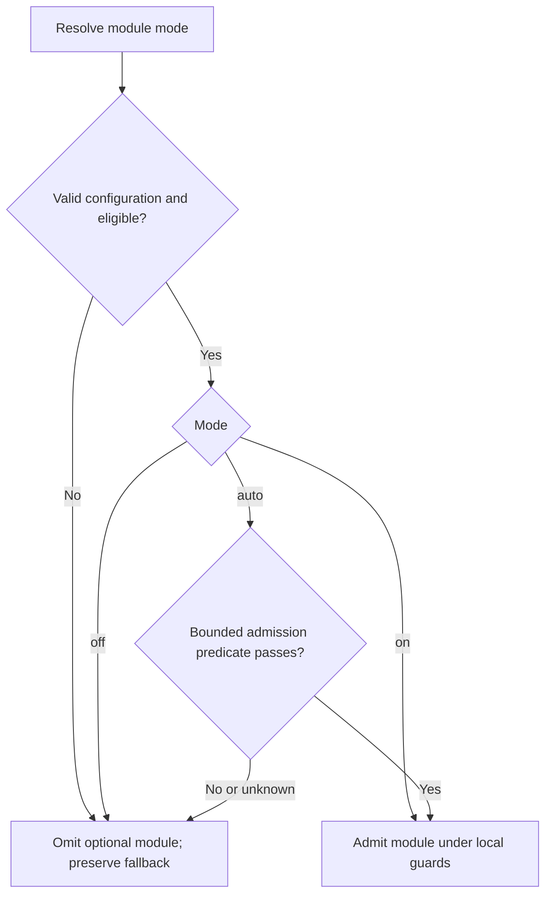

# Optional module admission (prototype)

`ThalamicReticularNucleus` admits or inhibits optional processing using cheap,
deterministic turn facts. The thalamic reticular nucleus (TRN) is a narrow analogy
for inhibitory relay control. This prototype does not model biological fidelity,
executive authority, or a global brain power switch. It introduces no learned
feedback policy, model classifier, or recursive meta-router.

| Component | Responsibility |
| --- | --- |
| `Thalamus` | Relay selected memory streams into context. |
| `SalienceNetwork` / `PredictiveCodingController` | Produce control signals and processing-demand estimates. |
| `BasalGanglia` | Select cooperative actions. |
| `Hypothalamus` | Bias processing from resource pressure and feedback. |
| `ThalamicReticularNucleus` | Decide whether a registered optional module may run. |
| Admitted module | Produce its own result under its existing local guards. |

## Inventory and controls

The initial registry is explicit and immutable. Defaults preserve the existing
switches; introducing the registry does not activate automatic policies.

| Functional module ID | Owning controller method | Default | Legacy switch |
| --- | --- | --- | --- |
| `conversation_selective_consultation` | `_run_routing_stage` (post-draft) | `off` | `DUALBRAIN_CONVERSATION_SELECTIVE_CONSULT` |
| `acc_monitor` | `_run_conflict_regulation_stage` (final answer) | `on` | `DUALBRAIN_ACC_MONITOR` |
| `cerebellar_correction` | `_run_conflict_regulation_stage` (final answer) | `on` | `DUALBRAIN_CEREBELLUM_MICRO_CORRECTION` |

Canonical configuration is `DUALBRAIN_MODULE_<UPPER_ID>_MODE=on|off|auto`.
For example, configure automatic decisions for subsequent turns with:

```bash
export DUALBRAIN_MODULE_CONVERSATION_SELECTIVE_CONSULTATION_MODE=auto
export DUALBRAIN_MODULE_ACC_MONITOR_MODE=auto
export DUALBRAIN_MODULE_CEREBELLAR_CORRECTION_MODE=auto
```

The canonical variable wins when present, including when its value is invalid.
Existing Boolean `1`/`0` aliases remain supported. If neither canonical nor legacy
configuration is present, use the inventory default. An invalid explicit value
disables that optional module and produces a bounded configuration reason.

- `off`: omit this optional module at its registered phase.
- `on`: admit it when eligible; existing local guards still apply.
- `auto`: admit it only when eligible and its bounded automatic predicate passes.

Eligibility and protected controls veto even `on`. Automatic admission never
bypasses a module's checks. For the selective router, disabled means retain legacy
consultation routing; it does not mean consultation or System2 is forced off.
ACC monitoring and cerebellar correction keep their independent controls.
`acc_monitor` controls final-answer monitoring only; pre-routing ACC overrides
remain independent and retain their existing authority.

The broader switch inventory sets the boundary for later work:

| Existing control | Current owner | Treatment |
| --- | --- | --- |
| `system2_mode` and `DUALBRAIN_SYSTEM2_PRIORITY*` | System2 activation/settings | Protected caller mode and priority; preserve authority. |
| `DUALBRAIN_ACC_OVERRIDE_CONSULT`, `DUALBRAIN_ACC_SYSTEM2_BUMP`, `DUALBRAIN_ACC_TEMPERATURE_DROP` | Pre-routing ACC | Separate opt-in interventions; retain existing defaults/thresholds. |
| `DUALBRAIN_SYSTEM2_LOW_SIGNAL_FILTER` | System2 refinement | Keep validation local. |
| `DUALBRAIN_SYSTEM2_STALLED_FOLLOWUP` | System2 refinement | Possible later optional phase; retain round/progress guards. |
| `executive_mode`, `executive_observer_mode` | Observer/adviser/director preparation | Preserve named caller modes; a later gate must target a specific function. |
| Default-mode reflection injection | Unconscious stage / `DefaultModeNetwork` | Next migration candidate: `default_mode_reflection_injection`; retain history, cooldown and existing load/suppression checks. |
| `REASONING_DIAL` | Engine reasoning settings | Selects a reasoning mode rather than optional execution. |

Salience, prediction, thalamic relay and hypothalamic resource signals stay fact
producers. This prototype does not migrate these remaining controls.



## Automatic predicates

Selective consultation requires guarded conversation memory, an answerability
gate, a left-led turn, capable System2 in `auto`, and non-precision priority
(`balanced` or `latency`). Source
writes, forced-right leads, director force/skip, precision preference, and existing
ACC/amygdala overrides retain authority. System2 `auto` defaults to **precision**;
selective routing still requires an explicit non-precision choice, such as
`DUALBRAIN_SYSTEM2_PRIORITY_AUTO=balanced`. The registry never changes that choice.

Its automatic predicate accepts only a positively recognized single literal
record-repeat request, a resolved reference, one currently approved record,
exact complete draft/source-answer equality (ignoring outer whitespace),
high finite confidence (`>= 0.85`), and zero
risk. These facts supplement the existing support and source-lifecycle checks.
Recognized requests include “Repeat the recorded answer for Project Amber verbatim”
and “Amberの記録をそのまま再掲して”; identity aliases are removed by the existing
scope resolver before whole-request matching. Other phrasing falls back normally.
Unknown coverage, reasoning, review, calculations, or multiple requested
conditions retain legacy routing. In `auto`, only a child router's `skip` proposal
may change routing; `consult` and `defer` preserve the legacy decision. Manual
`on` preserves the existing router's full skip/consult/defer behavior within scope.

ACC automatic admission requires a known cheap micro-critic result or a
risk/uncertainty signal (finite risk above zero or confidence below `0.85`).
A known micro result has a recognized domain, including a clean result;
an unknown domain alone does not trigger observation.
Cerebellar automatic admission requires known,
high-confidence issues (`>= 0.88`, one to four issues in v1). Its forward forecast,
external-model availability, correction thresholds, and subsequent checks still
decide whether correction runs. Admission is not an assertion of correctness or
a promise that a provider call will occur.

Literal completeness comes first because the selective pilot passed **6/7 jointly
graded trials versus legacy's 7/7**. The missing case involved requested capacity
labels despite a correct numeric result; selective and forced-on both missed it.
Aggregate selective 7/8 includes a passing case unavailable in legacy and does
not establish preserved quality. See the [measured result](benchmarks/selective-consultation-2026-11-01.md).
This prototype makes no broad automatic-activation, quality, or paid cost claim.

## Facts and observability

Policies consume typed, immutable facts: bounded modes/statuses, finite numeric
signals, counts, and explicit completeness flags. Facts carry no raw questions,
answers, source values, project names, or record identifiers. Existing components
derive those facts; admission policies do not retrieve evidence or call providers.
Missing/unknown facts cannot establish automatic eligibility. A failed admission
decision omits the optional module using its registered fallback.

Per-turn `module_gate` telemetry records the module, phase, policy version,
requested mode, configuration source, effective admission, and bounded reason.
The metrics projection is `metrics.modules.gates`. Existing module events
record actual execution and final routing separately: admitted, executed, and
consulted are different outcomes. Gate telemetry carries no conversation content.

## Naming and registration rules

Use anatomical names for inspired components: `ThalamicReticularNucleus` in
`core/thalamic_reticular_nucleus.py`. Use stable functional `lower_snake_case`
module IDs and derive canonical environment names by uppercasing those IDs.
Registering another optional function does not require another anatomical name.

Every new registration must define:

1. An owner, stable ID, execution phase, policy version, and compatibility default.
2. Eligibility/protected controls, a safe fallback, and a bounded `auto` predicate.
3. Typed fact producers and bounded, content-free observable reasons.
4. Tests for mode precedence, local guards, unknown/error fallback, and relevant
   completeness failures, plus quality and cost evidence before broader admission.

Policies are explicit pure deterministic functions in a fixed registry. They
cannot discover code, call providers, register themselves, depend on other gate
decisions, form policy cycles, or learn from runtime feedback in this version.
Keep operational, evidence, persistence, security, and cancellation gates outside
this optional-module registry. Source approval and lifecycle validation remain
mandatory. Extending admission requires evidence for the new scope; adding a
registry entry alone does not justify enabling its automatic policy by default.
