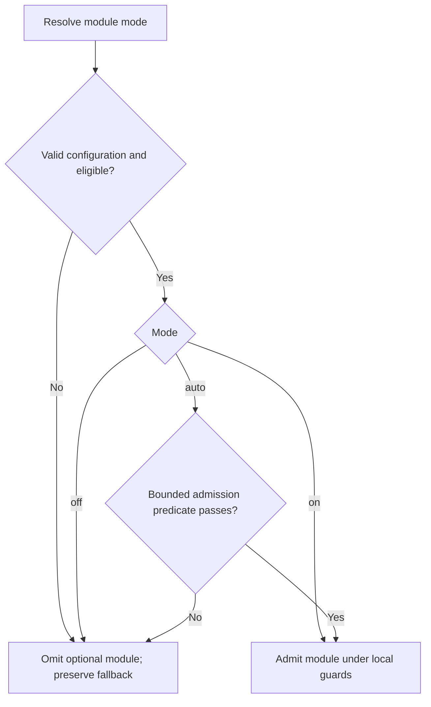

# Optional module admission (prototype)

`ThalamicReticularNucleus` admits or inhibits optional processing using cheap,
deterministic turn facts. The thalamic reticular nucleus (TRN) is a narrow analogy
for inhibitory relay control. This prototype does not model biological fidelity,
executive authority, or a global brain power switch. It introduces no learned
feedback policy, model classifier, or recursive meta-router.

| Component | Responsibility |
| --- | --- |
| `Thalamus` | Relay selected memory streams into context. |
| `SalienceNetwork` / `PredictiveCodingController` | Produce control signals and processing-demand estimates. |
| `BasalGanglia` | Select cooperative actions. |
| `Hypothalamus` | Bias processing from resource pressure and feedback. |
| `ThalamicReticularNucleus` | Decide whether a registered optional module may run. |
| Admitted module | Produce its own result under its existing local guards. |

## Inventory and controls

The registry is explicit and immutable. Defaults preserve the existing
switches; introducing the registry does not activate automatic policies.

| Functional module ID | Owning controller method | Default | Legacy switch |
| --- | --- | --- | --- |
| `conversation_selective_consultation` | `_run_routing_stage` (post-draft) | `off` | `DUALBRAIN_CONVERSATION_SELECTIVE_CONSULT` |
| `acc_monitor` | `_run_conflict_regulation_stage` (final answer) | `on` | `DUALBRAIN_ACC_MONITOR` |
| `cerebellar_correction` | `_run_conflict_regulation_stage` (final answer) | `on` | `DUALBRAIN_CEREBELLUM_MICRO_CORRECTION` |
| `default_mode_reflection_injection` | `_run_unconscious_resonance_stage` | `on` | None; existing suppression/cooldown remain |
| `system2_stalled_followup` | `_run_system2_refinement_stage` | `on` | `DUALBRAIN_SYSTEM2_STALLED_FOLLOWUP` |
| `executive_advice` | `_prepare_observer_stage` | `on` within requested caller mode | `executive_mode=observe/assist/polish` remains required |
| `director_advice` | `_prepare_observer_stage` | `on` within requested caller mode | `executive_observer_mode=director/both` remains required |
| `executive_metrics_observation` | `_run_post_turn_observer_stage` | `on` within requested caller mode | `executive_observer_mode=metrics/both` remains required |
| `acc_consult_promotion` | `_run_routing_stage` | `off` | `DUALBRAIN_ACC_OVERRIDE_CONSULT` |
| `acc_system2_promotion` | `_run_routing_stage` | `off` | `DUALBRAIN_ACC_SYSTEM2_BUMP` |
| `acc_temperature_adjustment` | `_run_routing_stage` | `on` when amount is positive | `DUALBRAIN_ACC_TEMPERATURE_DROP` remains the amount, default `0` |
| `basal_consult_promotion` | `_run_routing_stage` | `on` under the existing loop recommendation | None; ACC/salience-driven consultation override |

All twelve entries are connected to their production admission point. The nine
follow-on migration candidates are implemented; no candidate in this inventory
is a registration-only placeholder. This inventory covers optional work selected
by the controller's public modes/enable switches plus DMN prompt injection.

Canonical configuration is `DUALBRAIN_MODULE_<UPPER_ID>_MODE=on|off|auto`.
For example, configure automatic decisions for subsequent turns with:

```bash
export DUALBRAIN_MODULE_CONVERSATION_SELECTIVE_CONSULTATION_MODE=auto
export DUALBRAIN_MODULE_ACC_MONITOR_MODE=auto
export DUALBRAIN_MODULE_CEREBELLAR_CORRECTION_MODE=auto
```

The canonical variable wins when present, including when its value is invalid.
Existing Boolean `1`/`0` aliases remain supported. If neither canonical nor legacy
configuration is present, use the inventory default. An invalid explicit value
disables that optional module and produces a bounded configuration reason.

- `off`: omit this optional module at its registered phase.
- `on`: admit it when eligible; existing local guards still apply.
- `auto`: admit it only when eligible and its bounded automatic predicate passes.

Eligibility and protected controls veto even `on`. Automatic admission never
bypasses a module's checks. For the selective router, disabled means retain legacy
consultation routing; it does not mean consultation or System2 is forced off.
ACC monitoring and cerebellar correction keep their independent controls.
`acc_monitor` controls final-answer monitoring only. Pre-routing ACC interventions
have three independent registrations and keep their configured signal thresholds.
For temperature adjustment, `on` cannot invent a positive drop amount.

The remaining controls have an explicit disposition:

| Existing control | Current owner | Treatment |
| --- | --- | --- |
| `system2_mode` and `DUALBRAIN_SYSTEM2_PRIORITY*` | System2 activation/settings | Protected caller mode and priority; preserve authority. |
| `DUALBRAIN_SYSTEM2_LOW_SIGNAL_FILTER` | System2 refinement | Keep validation local. |
| `DUALBRAIN_CRITIC_MICRO_FALLBACK`, `DUALBRAIN_CRITIC_JSON_REPAIR_CALL`, `DUALBRAIN_CRITIC_MICRO_SANITY_OVERRIDE` | Right-model critic | Keep response-contract recovery and validation local; these are not optional cognitive admission. |
| `executive_mode`, `executive_observer_mode` | Caller | Retain named output/director semantics; TRN may omit a selected function but cannot select a mode that was not requested. |
| `REASONING_DIAL` | Engine reasoning settings | Selects a reasoning mode rather than optional execution. |
| Memory scope/support/currentness, commit/recovery and embedding availability | Memory pipeline | Mandatory evidence and lifecycle contracts; retain local ownership. |
| Deadlines, cancellation, request identity, capacity and stream/vision I/O | Engine / callosum / Gateway | Operational contracts; retain local ownership. |
| Audit/sanitization and critic filtering | Answer validation | Mandatory validation; retain local ownership. |

Salience, prediction, thalamic relay and hypothalamic resource signals stay fact
producers. Unconscious analysis and DMN history/cooldown updates also stay active
as fact/state producers. The excluded controls are intentionally retained, rather
than unfinished migration candidates. New optional execution sites must join the
registry under the rules below; a new inventory item needs an explicit disposition.



## Automatic predicates

Selective consultation requires guarded conversation memory, an answerability
gate, a left-led turn, capable System2 in `auto`, and non-precision priority
(`balanced` or `latency`). Source
writes, forced-right leads, director force/skip, precision preference, and existing
ACC/amygdala overrides retain authority. System2 `auto` defaults to **precision**;
selective routing still requires an explicit non-precision choice, such as
`DUALBRAIN_SYSTEM2_PRIORITY_AUTO=balanced`. The registry never changes that choice.

Its literal-replay branch accepts a positively recognized single literal
record-repeat request, a resolved reference, one currently approved record,
exact complete draft/source-answer equality,
high finite confidence (`>= 0.85`), and zero
risk. These facts supplement the existing support and source-lifecycle checks.
Recognized requests include “Repeat the recorded answer for Project Amber verbatim”
and “Amberの記録をそのまま再掲して”; the scope resolver retains a single alias's
position so only an allowed identity slot can participate in whole-request
matching. Other phrasing falls back normally.

The literal-replay branch binds that request to one live primary source in the whole
scope before retrieval ranking. The support checker receives a typed quotation
operation and must quote the entire recorded answer; approvals bind exact query,
source, scope and policy. A correction plus “その記録をそのまま再掲して” or a bounded
“Repeat that recorded answer verbatim” can carry the existing unambiguous focus.
The approved context exposes a complete JSON `recorded_answer` for normal
generation, without framing or new verification claims. A supported exact
quotation may be qualitative; no arithmetic inference is required. Incomplete,
inactive, ambiguous, multi-record or extra-clause requests keep ordinary handling.
The [prospective record-replay protocol](benchmarks/record-replay-protocol.md)
separates support decisions, exact text reproduction and final-answer grading.
Unknown coverage, reasoning, review, calculations, or multiple requested
conditions retain legacy routing. In `auto`, only a child router's `skip` proposal
may change routing; `consult` and `defer` preserve the legacy decision. Manual
`on` preserves the existing router's full skip/consult/defer behavior within scope.

`literal_or_choice_clarification_v3` also admits two bounded source-free states:
`clarify_record` with current unselected records, and `reselect_record` with an
unavailable selection. The fresh typed memory condition must resolve the caller's
reference and recognize the whole-record grammar. There must be no approved
record, and the draft must equal one of the fixed English/Japanese selection
replies in `record_choice_clarifications`. The PFC supplies these optional exact
reply forms; arbitrary paraphrases, extra claims, changed conditions, other
missing-evidence actions and unknown signals retain ordinary routing. High finite
confidence and zero risk remain required. No semantic classifier is introduced.
The route reports `bounded_record_clarification` and the final System2 reason
`selective_record_clarification`, without claiming supported source delivery.
Default OFF and all protected System2/Director/priority/override rules remain.


ACC automatic admission requires a known cheap micro-critic result or a
risk/uncertainty signal (finite risk above zero or confidence below `0.85`).
A known micro result has a recognized domain, including a clean result;
an unknown domain alone does not trigger observation.
Cerebellar automatic admission requires known,
high-confidence issues (`>= 0.88`, one to four issues in v1). Its forward forecast,
external-model availability, correction thresholds, and subsequent checks still
decide whether correction runs. Admission is not an assertion of correctness or
a promise that a provider call will occur.

DMN automatic injection requires a generated reflection with finite confidence
`>= 0.6`, finite task-positive load below `0.62`, and finite zero risk. Existing
low-focus streak, thalamic and predictive suppression veto all modes, including
`on`. Reflection generation still advances history and cooldown even when prompt
injection is `off`. Private/debug reflection records remain separate from injection.

Executive advice, director advice and post-turn metrics use the versioned
`confirmed_recovery_v4` AUTO predicate, requiring non-empty, nontrivial
input and a feasible known time budget. Caller modes and model availability are hard
eligibility requirements. Defaults preserve requested `observe`/`assist`/`polish`
behavior; AUTO may omit the selected function on trivial input and never converts
one named mode into another. Advice/director admission happens before task creation;
metrics admission happens after a final answer. Existing timeouts and cancellation
ownership continue to govern admitted work.
`Hypothalamus` owns a session-local history of usable external completions and
censored cancellation bounds, separately for each role and effective model/config.
It retains at most 32 profiles with 16 samples each; observations expire after
60 seconds. No prompts, answers, auth keys or headers enter this history. Changes
to effective provider/model/endpoint/output-limit/timeout/continuation settings
separate profiles. Non-provider/custom models without a known config stay unknown.

Director and post-answer metrics use compact request contracts: within explicitly
selected AUTO mode, built-in external models use role-specific compact request
views. Director retains every operational control in a sparse object plus one
240-character memo; metrics returns only a 240-character monitoring memo and
confidence, never pre-answer directives or user-facing additions. The full user
question stays available. Existing context/snippet bounds stay, so monitoring
must acknowledge partial coverage and cannot certify omitted content or an
unobserved operation. Executive pre-answer advice keeps its full contract.

Compact requests cap output at the smaller of the configured cap and 256 tokens,
disable continuation for that request, and require a successful completion status
and strict typed JSON. Truncated, malformed and error output is unavailable advice,
with empty controls; it cannot be learned as successful external latency. Shared
client configuration is never mutated. Effective compact contract/cap enter the
history fingerprint before admission and again at actual start. Changing that
contract cannot inherit full-request observations. Manual ON/defaults keep full
requests; OFF creates no work. Custom models keep their existing API. These are
request contracts within the registered modules, not additional enable switches.

Director's `local_controls_v6` adds a bounded fact projection owned by Hypothalamus.
Explicit normalized System2 ON with an active, capable subsystem supplies
consultation preservation; an existing explicit whole-stream memory restriction
can supply long-term context suppression. Absent memory and mixed relay decisions
do not establish such a restriction. Unknown answer length, clarification,
temperature and memory intent remain absent controls. System2 OFF does not mean
ordinary consultation is skipped. No new text classifier or source-write intent
inference is introduced.

Within requested Director AUTO, TRN declines the remote task with
`local_controls_ready` when these sparse constraints are ready, and they are
applied before drafting with `local_facts` provenance. Both whole pre-draft-stage
duration and actual routed control use are evaluated. Local output is not a model
completion or external latency sample. ON/default requests keep their remote
contract; OFF creates no new local plan. The independent trivial-turn fast path
and mandatory caller/source/evidence rules retain their existing authority.

The estimate is the largest recent observation, labeled `completed_max` or
`censored_bound`, with separate sample counts. A cancellation records elapsed time
until its first cancellation request, excluding cleanup; it is a lower bound,
not a completion time. Empty/error outputs and cancellation before work starts
do not teach a successful fast latency. This conservative heuristic is not a
guarantee of future completion. Expiry permits a new cold probe after inhibition.

AUTO additionally permits a bounded recovery probe before expiry. Hypothalamus
produces a content-free status after 15 seconds since the latest observation;
each retained role/model profile can start at most one recovery probe in a rolling
60 seconds. A known budget must allow at least the full 1,600 ms Director window,
2,500 ms metrics window or 2,000 ms for Executive. ON/OFF and normal cold work do
not consume this separate allowance. TRN remains a pure admission function.

An opaque lease is claimed at actual work start, after rechecking the current
profile, remaining deadline and allowance. Cancellation before start consumes
nothing; competing claims cannot multiply probes. A structurally usable external
completion whose elapsed time plus 50 ms fits its claimed budget becomes provisional.
V4 permits at most one confirmation on a subsequent requested phase; normal
admission resumes only after two fresh usable completions fit the window with
`max(latencies) + range(latencies) + 50 ms`. Only older evidence is superseded;
newer concurrent observations also have to fit and remain in history. Confirmed
profiles continue to include observed completed-latency range in their estimate.
This is a conservative allowance, not a statistical confidence guarantee.
Slow, cancelled, empty or failed exploratory work spends its allowance. Its
observation time stays accurate, but its expiry cannot exceed the original
blocking evidence, preserving the original cold opportunity. A separate hold
prevents sample-ring eviction from bypassing confirmation. Sample
expiry alone cannot reset a recent probe allowance. The bounded 32-profile LRU
store may discard a profile; it subsequently has ordinary unknown/cold behavior.
No classifier, recursive gate, user-facing recovery flag or default-mode change
is introduced. The internal recovery-disabled ledger is a v2-equivalent
comparison fixture, not an additional deployment switch. The confirmation-disabled
ledger similarly supplies a v3-equivalent comparison. Unusable ordinary output
after promotion suspends ordinary AUTO work until existing evidence expires or
bounded recovery succeeds, without treating failure as a fast latency.

The Director's known local wait is 1,600 ms and post-turn metrics' wait is
2,500 ms, capped by an existing RPC deadline when present. Executive advice runs
in parallel with drafting and consultation, so its later wait timeout does not
describe its whole available window: only a known outer RPC deadline bounds
admission; outside RPC its window is unknown. AUTO inhibits work when the known
budget is at most 50 ms or the estimate plus a fixed 50 ms reserve reaches the
budget. Outside pending confirmation and unusable-output quarantine, unknown
latency/window preserves the previous nontrivial-input cold probe; invalid explicit
numeric facts inhibit. Manual `on` ignores the estimate but
cannot start work after a known deadline/turn abandonment. Defaults remain `on`
within requested modes; no automatic policy is enabled by default.
When the estimate does not fit, AUTO may admit only the explicit bounded
recovery permission described above; otherwise it preserves v2 inhibition.

The Director's caller-selected deterministic trivial-chat steering is separate
from its provider task: it keeps consultation skipping, short output and long-term
memory suppression even when the optional task is off, inhibited or unavailable.
An observer mode that does not request Director applies no such control.
Director consultation skipping cannot suppress an explicitly active System2 `on`.

### Final System2 routing and observed execution

The early `system2_mode` event is labeled `phase: initial`. A common
`phase: routing` event records the final decision after ACC, Director and selective
consultation. `metrics.system2.enabled` and `reason` use this final routing state.
An ACC promotion is therefore visible as `enabled: true, reason: acc_bump`.
When Director suppresses an active AUTO route, the final state is disabled with
`reason: director_skip` and a zero round target. That bookkeeping change preserves
the previous inhibition of post-answer micro-correction; it creates no replacement
model call. Explicit System2 ON continues to block Director skipping.

Routing admission does not establish that a critic ran. The separate
`system2_execution` event and metrics record:

| Field | Meaning |
| --- | --- |
| `used` | A critic request was actually invoked, including a failed or cancelled attempt. Ordinary `ASK_DETAIL` requests do not count. |
| `critic_attempts`, `critic_responses` | Controller-level critic requests and returned responses, including direct fallbacks. Internal provider retries, repair calls, tokens and billing retain their own receipts. |
| `attempted_rounds` | Distinct requested rounds; fallback attempts share their original round. |
| `review_completed`, `external_review_completed` | Explicit review-validity flags from the **latest** returned attempt. A failed/cancelled latest attempt is false. An adapter without validity metadata is unknown (`null`). |
| `attempts` | Per-attempt round, source, outcome, safe error category and review validity. Earlier valid reviews remain inspectable after failed verification. |
| `local_recovery` | Independent local micro-critic recovery after timeout, when present. It does not certify the failed external request. |

Initial, verification and third-round validation metadata also flow through the
refinement event and metrics. Existing `rounds` retains its established attempted
round semantics, including timeout and cancellation. Metrics derive it from distinct
`attempted_rounds` when execution metadata is present; same-round fallback requests
count once. Events without execution metadata retain the previous refinement/policy
round projection and unknown execution/completion values. Use the explicit completion
fields to inspect review availability. Hippocampal storage, consolidation and Basal
Ganglia feedback now derive `system2_used` from observed critic invocation rather
than admission. The deterministic full-process regressions are in
`tests/test_system2_execution_state.py`.

Pre-routing ACC AUTO normally requires known micro issues (one to six), finite micro
confidence `>= 0.86` and finite conflict `>= 0.75`, in addition to existing
configured thresholds. The three interventions are independent; System2 promotion
also requires inactive, capable System2 in caller `auto` mode. Lowering the local
threshold cannot lower these versioned AUTO floors. Disabling all interventions
avoids their shared micro/monitor preparation.

The opt-in consult/System2 promotions also accept a bounded memory review cue
(`acc_memory_review_v2`): different answer text for the exact same source question
and declared scope among complete, current, uniquely identified, approved QA
records actually supplied in context. It requests reconciliation, not a verdict
about truth or inferred supersession. This branch requires capable, left-led
System2 AUTO; it respects context suppression, explicit OFF and each promotion's
gate. Both promotion defaults remain OFF. Memory competition does not authorize
temperature adjustment or basal-loop promotion; existing independent salience
pressure keeps its own authority. Equivalent answer wording can cause a review;
different questions/languages can conceal real conflicts. See the
[prospective protocol](benchmarks/memory-review-protocol.md) for this limited scope.

The basal loop's consultation promotion is a separate admission site: computing
ACC facts must not silently bypass a declined AUTO intervention through that loop.
Basal signal computation stays active under its existing conditions. Its AUTO
promotion requires the same strong micro/conflict facts or the existing salience
memory-recall/System2 pressure signal; trivial turns are omitted. Its default `on`
preserves the old loop recommendation path, independently of direct ACC promotion.

Stalled-follow-up admission controls only the extra stalled checklist path;
ordinary progress-based follow-ups keep their existing policy. Remaining issue
count, lack of progress, configured minimum issue count and a third-round budget
remain hard guards. AUTO additionally needs an unresolved structured external
`issues` verdict, critic detail, finite confidence `>= 0.85` and at most six
remaining calibrated issues. Unknown/unstructured critique cannot trigger it.

Literal completeness comes first because the selective pilot passed **6/7 jointly
graded trials versus legacy's 7/7**. The missing case involved requested capacity
labels despite a correct numeric result; selective and forced-on both missed it.
Aggregate selective 7/8 includes a passing case unavailable in legacy and does
not establish preserved quality. See the [measured result](benchmarks/selective-consultation-2026-11-01.md).
This prototype makes no broad automatic-activation, quality, or paid cost claim.
The [first twelve-gate pilot](benchmarks/module-gating-2026-11-01.md) retained
8/8 graded answers in both profiles with 22 versus 19 processing attempts. It
also exposed replacement work on trivial turns, deadline cancellations and seven
gates without positive AUTO exposure; those limits govern the next work.
Its trivial-steering issue was repaired before merge; a
[separate two-input confirmation](benchmarks/module-gating-steering-2026-11-02.md)
preserved 2/2 answers per profile with 4 versus 0 post-draft attempts and no
replacement consultation. Unknown cancellation billing still limits cost claims.
The [time-budget pilot](benchmarks/advisor-budget-2026-11-02.md) then retained
3/3 nontrivial answers per profile with 16 versus 8 processing attempts under
matched observed warm history. Six avoided advisor timeouts explain six of
those eight requests; differing UDP critic rounds explain the other two.
Warmup overhead and unknown cancellation usage preclude an exact savings claim.
The [persistent-session sequence](benchmarks/advisor-sessions-2026-11-03.md)
then measured 38 versus 30 whole-turn attempts across six serial turns per arm,
including primary generation and a real 61-second idle. It repaired local-wait
interference with RPC cancellation and exposed slow-history suppression of newly
fast roles. A rubric/question mismatch limits its raw 4/6 versus 5/6 grades;
the report retains original grades and does not claim a quality improvement.
The [bounded-recovery study](benchmarks/advisor-recovery-2026-11-03.md) then
demonstrated a real metrics recovery before TTL expiry and 5/5 graded tasks in
both profiles. Whole-turn attempts were 26 versus 25, but usable advisor outputs
were 8 versus 6. A successful probe was followed by an ordinary timeout; bounded
recovery works mechanically, while stable utility under latency jitter remains
an open evaluation target. No cost or quality improvement is established.

## Ordinary detail completion

Built-in `RightBrainModel.deepen` requires nonempty terminal output and disables
continuation within its existing 450/900-token budget. Its typed result separates
external, heuristic and legacy output; empty, incomplete, invalid/refused and
provider failures carry no usable notes or positive confidence. Configured
provider failures are not replaced with simulated local success.

The worker retains this metadata. A known returned unusable detail result keeps
the draft without repeating the same provider call. A missing/error delivery
can use the existing one direct fallback, whose result is checked too. Explicit
legacy empty text is an unusable returned result; a legacy packet missing the
notes field is an unknown delivery. Custom nonempty legacy notes remain compatible
but carry no proof of external completion. Actual cancellation still propagates.
This is an operational completion contract, outside optional-module admission.

`detail_execution` and `metrics.detail` expose bounded delivery observations,
usability, external completion and fallback use, without notes or exception text.
Delivery counts are not provider HTTP attempts or billed usage. The event is
emitted when the stage resolves; absent metrics cannot establish a completed
delivery (the phase may be unreached or abandoned). Critic validation and System2 execution retain
their separate accounting. `success` requires usable returned material, including
after direct fallback; an empty fallback cannot improve success feedback.
The [controlled live clarification comparison](benchmarks/clarification-detail-2026-11-06.md)
reports shared-draft routing costs, explicit-mode controls and separately labeled
injected completion failures.

## Facts and observability

Policies consume typed, immutable facts: bounded modes/statuses, finite numeric
signals, counts, and explicit completeness flags. Facts carry no raw questions,
answers, source values, project names, or record identifiers. Existing components
derive those facts; admission policies do not retrieve evidence or call providers.
Missing required facts cannot establish automatic eligibility; optional timing
facts have the explicit cold-probe fallback above. A failed admission
decision omits the optional module using its registered fallback.

Per-turn `module_gate` telemetry records the module, phase, policy version,
requested mode, configuration source, effective admission, and bounded reason.
The metrics projection is `metrics.modules.gates`. Existing module events
record actual execution and final routing separately: admitted, executed, and
consulted are different outcomes. Gate telemetry carries no conversation content.
An absent gate event means its owning phase was not reached; it is not evidence
that the module was disabled. A turn can expose admission for all reached phases
even when no provider task is created.

`advisor_budget` and `advisor_work` expose bounded time facts and the task
lifecycle through `metrics.modules.advisor_timing`: admitted, started, completed,
timed out, cancelled, failed or never started; structurally usable output;
elapsed time, cleanup time and bounded stop reason. Structural usability does
not assert factual correctness. Task start is not proof of an HTTP attempt or
token receipt: runtime usage is `unknown` for started work and `not_started`
otherwise. The benchmark HTTP journal separately accounts for real attempts
and known/unknown billed usage. No diagnostics are added to user answers.
Timing diagnostics also expose recovery readiness/reason, retry delay, requested
probe/confirmation, actual starts, confidence state and bounded outcome. Admission can precede a failed
claim if another task consumed the allowance or the profile/window changed;
that task reports `not_started`, with no provider factory invoked.
Local advisor waits expire without cancelling/uncancelling the parent turn.
The turn's cancel-once guard stays available for actual abandonment and cleanup;
one advisor timeout cannot disable a later advisor timer or RPC deadline.

## Validation sequence

Finish the migration inventory before evaluating automatic behavior. First check
default/legacy compatibility, OFF/ON/AUTO at real call sites, protected-mode vetoes,
unknown signals, and stateful turn-to-turn behavior. Then exercise all AUTO modes
together and measure actual task creation, calls and final answers separately from
admission decisions. Run the full offline suite, real PostgreSQL and Gateway/UI
contracts before reviewing the change.

Broader live evaluation must compare frozen inputs and matched requested modes,
report quality and provider cost together, retain failed cells and distinguish
natural model outputs from injected faults. A deterministic fixture or fewer
admitted modules alone does not establish improved answer quality or paid savings.

## Naming and registration rules

Use anatomical names for inspired components: `ThalamicReticularNucleus` in
`core/thalamic_reticular_nucleus.py`. Use stable functional `lower_snake_case`
module IDs and derive canonical environment names by uppercasing those IDs.
Registering another optional function does not require another anatomical name.

Every new registration must define:

1. An owner, stable ID, execution phase, policy version, and compatibility default.
2. Eligibility/protected controls, a safe fallback, and a bounded `auto` predicate.
3. Typed fact producers and bounded, content-free observable reasons.
4. Tests for mode precedence, local guards, unknown/error fallback, and relevant
   completeness failures, plus quality and cost evidence before broader admission.

Policies are explicit pure deterministic functions in a fixed registry. They
cannot discover code, call providers, register themselves, depend on other gate
decisions, form policy cycles, or learn policy weights from runtime feedback.
Bounded observed resource facts may come from their existing owner, such as the
Hypothalamus timing history; the admission predicate remains deterministic.
Keep operational, evidence, persistence, security, and cancellation gates outside
this optional-module registry. Source approval and lifecycle validation remain
mandatory. Extending admission requires evidence for the new scope; adding a
registry entry alone does not justify enabling its automatic policy by default.
Gate the optional provider work at its own boundary; keep free deterministic
steering and mandatory local safeguards independent of whether its task exists.
