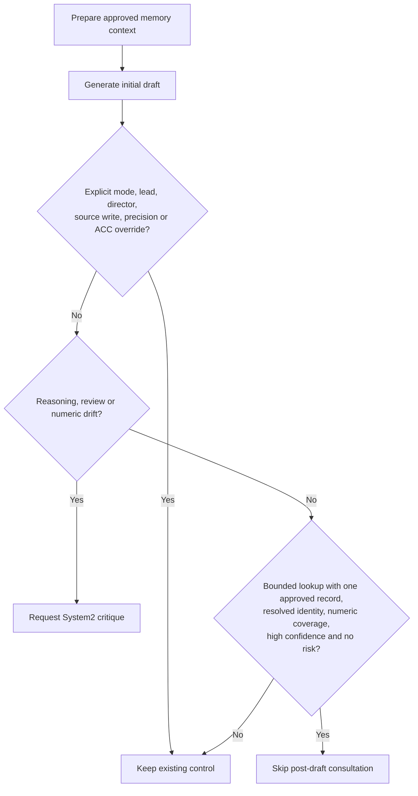

# Selective conversation consultation

Set `DUALBRAIN_CONVERSATION_SELECTIVE_CONSULT=1` to enable the experimental router.
It is off by default. It applies after drafting, only to left-led, guarded
conversation turns with an answerability gate in balanced System2 auto mode.
For a controlled deployment use `leading_brain="left"`, `system2_mode="auto"`
and conversation memory enabled. Auto-selected lead previews can already have
made calls before routing; this feature controls the subsequent consultation.

The router does not approve sources, change their verification status or prove
answer correctness. It uses cheap question/draft signals and the same currently
approved traces that can enter the model context. A `medium` question category
can be caused solely by a question mark after 26 characters, so that surface
signal alone does not block a supported lookup. Hard questions, explicit review,
reasoning markers and new numeric claims retain/request critique.

Skipping requires all numeric values from the single source answer to appear in
the draft; digits in declared aliases are excluded from required value coverage.
No numeric claim may be new relative to the source/question. These are conservative
surface checks, not semantic entailment: matching values cannot establish correct
units, relationships or qualifications. Existing confidence is also a heuristic,
not a calibrated provider score. Broader evaluation is required before making the
router the default. Standard comma-separated thousands groups are parsed as whole
values. Malformed grouping, space-separated groups, fractions and scientific or
multi-dot forms request consultation rather than silently comparing digit sets.
Unconsumed plus/minus signs, including signs before currency symbols/codes, also
request consultation. This intentionally includes some benign hyphenated text;
unsupported surface forms must not silently lose numeric polarity.

Missing, ambiguous, multiple, qualitative-only or incomplete evidence defers to
normal routing. So do low-confidence and risk signals. A successful support check
is still required for the fast path. Primary writes, `system2_mode="on"`/`"off"`,
right-led turns, precision priority, director `force`/`skip`, and existing ACC or
amygdala overrides retain their authority. Memory salience can be superseded for
a bounded lookup; the evidence gate and record lifecycle never are.

`consultation_route` telemetry records a bounded version/action/reason, prior and
final action/System2 flags, and approved-record count. It carries no question,
answer, project identifier or fact value. The same fields appear in
`metrics.policy.consultation_route`; the final post-draft System2 status is exposed
through `metrics.system2`. A skip means consultation was omitted, not that the
answer was independently verified.

See the [prospective pilot protocol](benchmarks/selective-consultation-protocol.md)
for the frozen-draft comparison, separate natural/synthetic strata, costs and
limits, and the [measured result](benchmarks/selective-consultation-2026-11-01.md)
for the observed call savings and remaining task-completeness gap. The preceding [persistent-answer pilot](benchmarks/persistent-answers-2026-10-28.md)
provides the factual-memory motivation, but its forced-on/off comparison does not
measure this new router or ordinary automatic routing.
