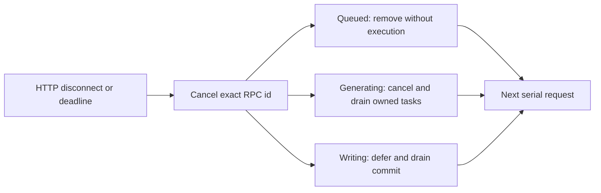

# Gateway and Python turn lifetime

An abandoned HTTP request now abandons its exact Python RPC attempt. The Gateway
uses a fresh RPC `id` for every attempt, separate from the caller's `qid` and from
persistent `memory_operation_id`. Late responses cannot complete a newer attempt
with the same qid. Cancellation never undoes an already committed operation.

The engine continuously reads control messages while one dispatcher executes
ordinary RPCs serially. This preserves the existing isolation of sessions, reset,
recovery, blob handling and shared caches; it does not introduce concurrent turns.
`health` and `cancel` bypass that execution queue. Health includes payload-free
`rpc.capacity`, `pending`, `queued` and `draining` counts and remains responsive
while a model awaits I/O. A coroutine blocking the event loop still blocks the reader.



## Deadlines and admission

The Gateway starts its linked timeout at call entry, covering engine startup,
write-lock admission, queue residence and response/stream consumption. It puts
`deadline_unix_ms` on the top-level RPC envelope. The same-host Python process
converts the remaining wall-clock budget once to its local monotonic clock.
The engine also checks the deadline before execution and before the first factual
write, even if synchronous work delayed the timeout callback.

`DUALBRAIN_ENGINE_TIMEOUT_SECONDS` retains the Gateway's default of 120 seconds
(and its 5–600 second clamp). Python uses it as its default budget, with optional
`DUALBRAIN_RPC_TIMEOUT_SECONDS` as a separate positive finite cap. A supplied RPC
deadline can only shorten the Python budget. Direct stdio callers without a
deadline receive the engine default. This is cooperative cancellation, not a
hard real-time execution limit.

`DUALBRAIN_RPC_MAX_PENDING` defaults to 64 and must be a positive integer. It
counts queued, running and draining RPCs. Excess requests return `Overloaded`
without running. Expired and cancelled queued work is removed immediately;
running work retains its slot through cleanup. These are request-count bounds,
not bounds on session count, payload bytes or the existing output queues.

## Cancellation and persistence

Before factual writes, cancellation stops generation, clears the abandoned
conversation scope/correction intent, restores the preceding focus, and drains
tracked previews, director/executive tasks and consultation provider cleanup.
The long-lived right worker has detached request context and survives to serve
the next turn. Events produced after abandonment are suppressed; already sent
SSE partials remain visible. Adaptive control counters are not transactionally
rolled back, and remote provider acceptance/billing cannot be revoked.

`DualBrainController` calls `begin_turn_commit()` immediately before its first
hippocampal/memory write, after validating any primary-source completion. From
that boundary through persistence and completion, cancellation is deferred.
Session creation/recovery, pre-generation outbox reconciliation, reset and blob
frame consumption also finish inside temporary barriers. Recovery barriers
check abandonment again before allowing new generation.

The dispatcher retains its serial slot until the handler and its owned cleanup
actually finish. In particular, cancelling an HTTP waiter cannot leave a database
operation in `asyncio.to_thread` writing concurrently with the next turn. An
abandoned terminal RPC reports `Cancelled` or `DeadlineExceeded` with conservative
`error.may_have_committed`; an acknowledgement with `deferred: true` says cleanup
or a protected operation is still running, not that persistence was rolled back.
A disconnected HTTP client may never receive either response. Durable callers
should retain their operation ID and use the existing
[memory reconciliation/receipt contract](memory-commit-recovery.md).

Custom controllers must call `begin_turn_commit()` before their own factual
writes and use `create_turn_task()` for detached turn-owned coroutines. The
engine's post-controller boundary protects its persistence call but cannot infer
or undo arbitrary earlier writes in extension code. Custom providers must cooperate
with cancellation; an indefinitely stuck provider/commit holds the serial slot.

## Transport and shutdown

A control frame is a normal JSON message with its own unique id:

```json
{"id":"control-attempt","method":"cancel","params":{"request_id":"original-attempt"}}
```

Cancel is idempotent while draining. Unknown/completed IDs return
`accepted: false`. An in-flight duplicate work ID abandons the original and
produces one terminal response; callers must use unique IDs for every attempt,
including controls and health checks.

The Gateway sends cancellation with an independent bounded token after an HTTP
abort, timeout or early stream disposal. It does not restart the engine to send
that signal, and it checks the process generation before writing. Once an RPC
frame starts writing, HTTP cancellation cannot truncate it: a separate five-second
wire grace allows it to finish. A partial/failed write terminates that process
rather than appending messages to a corrupt stream. Cancellation lock admission
has its own two-second budget and frame completion its own five-second grace;
these bounded wire-cleanup intervals can extend the caller's response timeout.
The process lifetime cancellation token still stops all writes during shutdown.

Both stdio lines and length-prefixed named-pipe RPC frames use that rule. Binary
uploads additionally own and await their writer and RPC together. A failed or
abandoned upload invalidates its captured process/pipe generation before reuse,
including a fully buffered frame whose queued RPC never consumed it. It cannot
leave a truncated/unread blob in front of the next upload. This transport reset
loses transient sessions; persistent memory uses the outbox/receipt recovery
contract after restart. Upload cancellation does not promise to preserve transient
state across a framing failure.

Normal
terminal stream delivery is marked complete before yielding, so disposing the
iterator after its final envelope does not send a spurious cancellation. HTTP
process timeouts return 504; live SSE timeouts emit an `error` event. Client
disconnects stop writing to that client. On RPC input EOF, queued work is abandoned
and active work drains before the writer, transport and sessions are closed.

## Verification

Model-free tests exercise queue expiry/overload, duplicate IDs, cancellation of
an awaited child with asynchronous cleanup on Python 3.10 and 3.12, protected
writes and shutdown. Engine integration uses a real controller for cancelled
primary-source generation and a gated threaded store to verify receipt recovery
and serial isolation during commit. Real HTTP disconnect and timeout tests run
against the .NET Gateway over both transports using a fake provider-free RPC
engine. They verify exact-attempt cancellation and successful reuse of the same
session/qid. No quality-score or paid-provider performance improvement is claimed.
